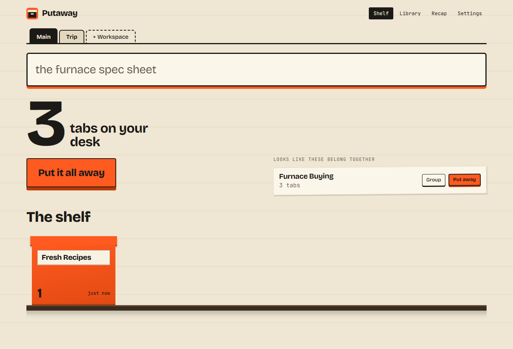

# Putaway

**Close every tab. Get it all back.**

You keep those tabs open because you're afraid of losing them. Putaway remembers
them for you, so you can finally close them.



It's free, open source and runs entirely on your computer. No account, no server.

## What it does

- **Put it all away.** One click turns your tabs into a labelled box on a shelf. Open the box whenever you need it.
- **Search by meaning.** Type what you remember, like "heating the house in january" or "visa deadline last week".
- **Jump to the sentence.** Results open the page and scroll to the passage you were looking for.
- **Keep what disappears.** If a page gets deleted, your saved copy is still there to read.
- **See what changed.** When a page you read gets edited, Putaway shows you exactly which lines are different.
- **Clear the clutter.** It finds duplicates and tabs you haven't touched in days, and suggests which tabs belong together.
- **Switch workspaces.** Swap your whole set of tabs between "Work" and "Apartment hunt".
- **Look back on your week.** See where your reading time went, and export it as Markdown.
- **Back up safely.** Move your library to another computer in a passphrase-locked file.

## Install

Made for Chrome, Edge and Brave on a computer.

1. Download `putaway-0.1.0.zip` from the [latest release](https://github.com/uchejohnchukwuma/putaway/releases/latest).
2. Unzip it to a folder you'll keep. Don't delete this folder later.
3. Go to `chrome://extensions` (`edge://extensions` in Edge) and turn on **Developer mode**.
4. Click **Load unpacked** and choose the unzipped folder.

Your browser may ask whether to keep the new tab page change, so choose to keep Putaway. It may also warn you about developer mode extensions, which is normal for anything installed outside a store.

## Update

Putaway tells you when a new version is out. It can't update itself yet.

1. Download the new zip and copy its files over your existing folder.
2. On the extensions page, click the reload icon on Putaway.

**Don't click Remove.** Removing the extension deletes your saved library.

## Privacy

Your pages and searches stay on your computer. Putaway skips incognito windows and, by default, won't save the contents of banking, mail, health, sign-in or checkout pages, or any page with a password field. The full rules and every permission are explained in [PRIVACY.md](PRIVACY.md).

The block list can't know every sensitive site, so add your own in Settings.

## Good to know

- Full-page search starts when you install it. Older history is searchable by title only.
- A page is saved after you've stayed on it for 15 seconds, or when you put it away.
- Search works best in English. It can miss a match when your words and the page share little meaning, so try other words.
- Each computer keeps its own library. There is no sync.
- It needs about 60 MB of disk space, plus your library.

## Build it yourself

```bash
npm ci
npm run fetch-model
npm run build
```

Then load the `dist` folder as an unpacked extension. To run the tests:

```bash
npm test
npm run test:e2e
```

See [docs/ARCHITECTURE.md](docs/ARCHITECTURE.md) for how it fits together.

## License

[MIT](LICENSE). The bundled search model is [all-MiniLM-L6-v2](https://huggingface.co/Xenova/all-MiniLM-L6-v2), Apache 2.0.
